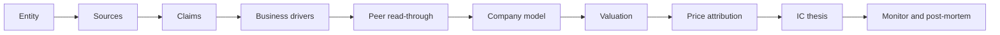

# IC Copilot

**Turn filings, calls, peer metrics, and market reactions into a citation-bound investment thesis that can also say: no convincing thesis yet.**

[](https://ic-copilot.streamlit.app/)
[](https://github.com/mwsp-code/IC-Copilot/actions/workflows/tests.yml)
[](LICENSE)
[](https://www.python.org/)

[Try the live demo](https://ic-copilot.streamlit.app/) | **[Give Feedback](https://github.com/mwsp-code/IC-Copilot/discussions/3)** | [Quickstart](docs/quickstart.md) | [Agent-led research](docs/agent-led-research.md) | [Methodology](docs/methodology.md) | [Roadmap](ROADMAP.md) | [Contribute](CONTRIBUTING.md)

## Why IC Copilot

Most AI research tools are good at producing text. IC Copilot is designed to produce an **auditable investment decision trail**:

- **Exact evidence:** filing section, period, metric, unit, source tier, URL, and parser status.
- **Causal reasoning:** source event -> business driver -> KPI -> earnings/FCF -> valuation -> catalyst.
- **Adversarial review:** Bull, Bear, and Judge views with unresolved contradictions kept visible.
- **Historical perspective:** same-company, industry, mechanism, and case-study analogs with source-independence checks.
- **News intelligence:** registered-source discovery, syndication-aware debate clustering, and primary-source corroboration.
- **Market-implied expectations:** reverse DCF and implied operating assumptions when historical consensus is unavailable.
- **A real ability to say no:** boilerplate, stale facts, unmapped drivers, and unsupported LLM claims do not become high-conviction ideas.

The app is built for equity analysts, credit analysts, portfolio managers, and AI builders who want evidence before eloquence.

## Try the Current Workflow

1. Open the [hosted app](https://ic-copilot.streamlit.app/). The AAPL Deep Initiation demo is loaded automatically on Decision.
2. Review the recommendation, valuation, market-implied expectations, historical playbook, and Bull/Bear/Judge summary.
3. Open Evidence to inspect the investigation trail, exact citations, validation state, and remaining material actions.
4. Switch to NVDA, BABA, or BLK to see a different research playbook.

The frozen demos require no API keys, make no paid provider calls, and contain no licensed full-text payloads.

## The Workflow



Every connection is scored separately. A weak link identifies the exact missing evidence instead of turning into generic uncertainty.

Results use four decision-oriented destinations. **Decision** answers the
investment question first; **Research** holds mechanisms and scenarios;
**Evidence** exposes validated claims, contradictions, requests, and quarantined
candidates; **Audit** shows Independent Research QA and the reproducible
integrity timeline. Technical identifiers stay behind progressive disclosure.

## Demo Gallery

| Demo | Research lesson |
|---|---|
| **AAPL** | Cash conversion, market-implied expectations, and evidence-backed investigation actions |
| **NVDA** | Neutral-first capex and goodwill investigation with semiconductor peer checks |
| **BABA** | ADR/FPI normalization, China cloud/AI mechanisms, and scope-safe historical analogs |
| **BLK** | Asset-manager economics from AUM and flows through fees, margins, credit, and per-share value |

## Quickstart

### Streamlit

```bash
git clone https://github.com/mwsp-code/IC-Copilot.git
cd IC-Copilot
python -m pip install -r requirements.txt
streamlit run app.py
```

### Audit evidence before a paid model run

```powershell
python scripts/audit_historical_retrieval.py --ticker AAPL --profile deep_initiation --refresh
```

This preflight uses no LLM. It reports which filings and sources were fetched,
which material claims are citation-ready, and which gaps are unavailable,
licensed/manual, or executable through another registered retrieval task.

Windows users can run the preflighted launcher instead:

```powershell
.\scripts\start_ic_copilot.cmd
```

### No-dependency local UI

```bash
python server.py --port 8501
```

The lightweight server automatically tries ports through `8510` when `8501` is occupied.

### Reopen research without another provider run

Completed and partial live results are saved automatically by local and
self-hosted Streamlit installations. Use **Saved research** in the sidebar to
load the latest completed result or an earlier investigation. Loading reads a
versioned local artifact only: it does not call an LLM, connector, or retrieval
adapter. Frozen demos, saved live research, and drafts have distinct labels.

Saved-result metadata and content-addressed compressed JSON payloads live outside
the repository in the operating system's per-user application-data directory.
Set `IC_COPILOT_SAVED_RESEARCH_DIR` to choose another location. Results remain
local until explicitly deleted. The public hosted app instead uses private,
expiring session storage and does not expose one visitor's research to another
visitor.

### Know exactly what will run

Investigation buttons select a typed research task; they do not call a provider.
The sidebar's **Next research task** card shows whether the selection is full
research, an event, a canonical action, an analog, or repair work, along with its
ticker, objective, sources, QA setting, and destination. Launch it once with the
task-specific confirmation button. An identical active task is reused, while an
identical completed task defaults to loading its saved result and requires an
additional confirmation before it can run again.

### Editable install for contributors

```bash
python -m pip install -e ".[dev]"
python -m pytest -q
```

Windows contributors can bootstrap and run the complete release gate with:

```powershell
.\scripts\quality.cmd -Bootstrap
```

See the [development guide](docs/development.md) for explicit-interpreter and
network-restricted environment guidance.

### Docker

```bash
docker build -t ic-copilot .
docker run --rm -p 8501:8501 ic-copilot
```

## Research Profiles

- **Fast Screening:** 4 quarters, 2 annual reports, 4 calls, and the highest-ranked anomaly.
- **Adaptive IC Research:** default; 12 quarters, 4 annual reports, 12 calls, and five material changes.
- **Deep Initiation:** 20 quarters, 5 annual reports, 20 calls, and deeper contradiction work.
- **Investigate This Event:** a filing-, call-, metric-, or news-scoped workflow.

Ambiguous changes are neutral first. Constructive and adverse explanations are investigated side by side before direction is assigned.

## Data and LLM Policy

SEC and issuer evidence remain the backbone. Official macro, market data, paid providers, Wisburg, and news can deepen context, but source tiers and licensing policies remain visible.

LLMs may plan registered sources, triage documents, draft structured extractions, compare evidence, and write an IC narrative. They cannot invent citations, targets, calibrated probabilities, or promotion decisions. Deterministic validation remains authoritative.

API keys are optional for the demos. For live work, save credentials through the OS keychain, environment variables, or Streamlit secrets. Never commit keys or licensed payloads. See [Provider Configuration](docs/providers.md).

| Integration class | Required? | Retention and authority |
|---|---:|---|
| SEC and public deterministic sources | Live research only | Normalized facts and citations; common no-lookahead checks apply |
| LLM API profile | No | Structured analysis only; cannot admit evidence |
| Local Codex | No | Ephemeral read-only QA; authentication tokens are never accessed |
| Wisburg/licensed research | No | Entitlement-aware metadata/excerpts; quarantined until common admission |
| Market/consensus provider | No | Provider terms apply; cache is policy/workspace isolated |

Optional Python development tools are declared under `.[dev]`; normal fixtures
and frozen demos require no vendor credentials. Each connector must document
its licensing and raw-payload retention policy.

### Quality-First Adaptive Research and Independent Research QA

Production research uses one deterministic bootstrap and one shared evidence
graph. Models have distinct jobs instead of duplicating the entire research
pipeline:

1. Deterministic adapters bootstrap, parse, validate, and admit the initial
   shared evidence graph, then publish a secret-free source-capability catalog.
2. The configured primary model builds a dynamic agenda and iteratively
   searches, reads, extracts, calculates, and replans through app-owned tools.
   A failed connector does not end a question; the model must change query,
   source family, document, or structured-data route before naming a blocker.
3. A distinct secondary model or authenticated local Codex independently audits
   the frozen artifact before it can see later discovery.
4. The secondary then acts as an adversarial scout and expresses gaps as
   versioned Research Requests.
5. Discovered URLs, snippets, contradictions, mappings, and specialist leads
   remain quarantined. Registered connectors retrieve them, and the common
   admission gateway alone can create evidence IDs.
6. The primary responds to every finding, revises conclusions using admitted
   evidence, and the secondary performs final closure checking.

Fast Screening, Adaptive IC, Deep Initiation, and Investigate This Event control
research breadth, investigative loops, and latency. They do not silently remove
configured and entitled evidence sources. Adaptive Macro is the default and
selects at most three material company exposures from domestic and global
context; macro cannot independently create or promote a thesis.

Each run records its source-policy fingerprint, admitted-evidence hash, evidence
graph version, model-role assignments, execution records, audit findings,
evidence gaps and resolutions, conclusion revisions, unresolved risks, and a
dimension-level Research QA score. Cached evidence can influence a run only when
it remains admissible under the current source policy and matches its source,
entitlement, cutoff, parser, and workspace isolation key.

Public Streamlit runs require explicit opt-in and a session-only primary key.
The independent auditor is optional: if its credential is absent, primary
research still completes and the QA report clearly states that independent
audit did not run. Keys are held only by the active process and are excluded
from SQLite, result JSON, logs, and manifests. Public execution uses configured
API providers; `codex_local` remains a trusted-workstation backend and is never
exposed through the public server API. Locally, authenticated Codex is
detected from the CLI or Codex Desktop runtime and preselected as auditor. If a
one-time connection is needed, the app launches the official `codex login`
flow; no additional API key is needed and the app never accesses authentication
tokens.

The previous two-choreography comparison remains available only through the
explicit `enable_two_choreography_benchmark` maintainer flag and offline
benchmark tooling. It is not part of the normal user workflow.

Every live result also carries a source-specific freshness summary for the
research run, filings, market price, consensus, news/external research, macro,
and LLM output. Audit records remain in UTC; the UI can display timestamps in a
user-selected timezone.

Models never receive unrestricted network access or provider credentials. They
request capabilities through an iterative application-owned tool gateway;
registered connectors perform retrieval, entitlement checks, normalization,
and admission. Search metadata and snippets remain in the exploration notebook
until permitted full content is retrieved and admitted. Historical candidates
are scored by mechanism, operating economics, financing, valuation,
competitive structure, macro regime, and source quality. Numeric similarity is
withheld until an independently sourced dossier passes deterministic and model
audits.

Stage-level comparisons classify recurring gaps as evidence, retrieval,
normalization, playbook, prompt, reasoning, schema, or presentation issues.
Suggested improvements are stored in a human-reviewable queue and must pass
cross-ticker evaluation. Runtime model output can never rewrite prompts or
production code.

### Quality-First Input Benchmark

Model quality is evaluated only after the evidence input qualifies. The app
keeps a materiality-ranked core prompt, a complete searchable evidence catalog,
current/prior period pairs, contradiction retention, and an exclusion reason
for every item outside the core. Identity, primary evidence, history, causal
KPIs, peers, management, valuation/credit, market context, contradictions, and
citation/period integrity form a 100-point input score. Model-quality
conclusions require at least 80/100 with no critical identity, period, citation,
or no-lookahead gap.

Quality-first Deep Initiation uses DeepSeek thinking/high reasoning and GPT-5.6
Sol Pro/max reasoning. There is no fixed pilot dollar cap. Ten model calls, two
deduplicated retrieval passes, one audited-call retry, cancellation, and a
greater-than-2x preflight review trigger remain visible. Token, cache, reasoning,
latency, retry, retrieval, and provider-charge observations inform later
profile-specific budgets.

Preview the six development cases without making provider calls:

```bash
python scripts/run_quality_benchmark.py --cohort development
```

Live execution is explicit:

```bash
python scripts/run_quality_benchmark.py --cohort development --execute
```

Add `--sol-open-reference` to run a separate web-enabled Sol source-scout lane.
Its URLs and claims remain discovery work orders; they are never admitted to the
app evidence pack until a registered deterministic adapter validates source,
date, ownership, licensing, and factual content.

The development cohort is AAPL, NVDA, BABA, JPM, XOM, and NVO. ORCL, TSLA, GS,
PLD, TSM, and PBR form the untuned validation cohort. The 30-case benchmark
remains blocked until at least five development cases are input-qualified and
the selection, period, contradiction, citation, and no-lookahead gates pass.

Maintainers can generate a validated frozen demo locally:

```bash
python scripts/generate_hybrid_demo.py --ticker AAPL --executor codex_local
```

Enable local Codex execution only on a trusted workstation with `ENABLE_LOCAL_CODEX_EXECUTOR=true`. Frozen artifacts contain provenance and validated output, but strip credentials, raw licensed payloads, hidden reasoning, and unsupported claims.

## Research Integrity Benchmark

The repository ships a no-network benchmark over 25 research-integrity cases across AAPL, NVDA, BABA, TSLA, and GS. It checks event grounding, thesis grounding, counter-thesis handling, monitor/payoff readiness, and promotion integrity.

```bash
python scripts/run_benchmark.py
```

This is an integrity benchmark, not a claim of investment performance. See [Benchmark Methodology](benchmarks/README.md).

## Architecture

IC Copilot separates deterministic evidence collection from hypothesis generation, valuation, monitoring, and optional LLM synthesis. Provider failures are isolated, normalized, and source-labelled; missing values remain `Unknown` rather than becoming zero.

See [Architecture](docs/architecture.md) and [Research Methodology](docs/methodology.md).

## Contributing

Useful first contributions include:

- Add a sector KPI playbook.
- Add an ADR/FPI profile.
- Add a canonical metric alias.
- Add a registered source adapter.
- Add a sanitized demo or benchmark case.

The UI and docs contain explicit contributor paths. Read [CONTRIBUTING.md](CONTRIBUTING.md), browse issues labelled `good first issue`, or start a design question in GitHub Discussions after it is enabled.

## Project Status

IC Copilot is research software under active development. It does not execute trades and does not provide financial advice. Frozen demos illustrate methodology; refresh live sources before using any observation in an investment process.

See [Roadmap](ROADMAP.md), [Security Policy](SECURITY.md), and [Changelog](CHANGELOG.md).

If IC Copilot improves how you think about evidence, consider starring the repository and sharing the benchmark with another analyst or builder.
