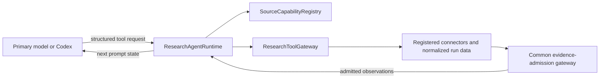

# Agent-led investment research

IC Copilot uses a model-directed research loop without granting models direct
access to credentials, the local repository, or unrestricted browsing.

## Runtime boundary

`SourceCapabilityRegistry` is populated from the same resolved providers,
entitlements, and caches used by execution. Its model-facing catalog includes
operations, freshness, licensing, cost, and availability, but omits
`CredentialReference`. Local secrets are resolved and decrypted inside the
application process only. Raw keys, tokens, leases, provider request bodies,
and authentication material are excluded from model prompts, saved research,
run manifests, and logs.

The gateway currently exposes source discovery and reading, SEC/XBRL facts,
market data, consensus history, macro observations, period comparison,
cash/financial bridges, reverse valuation, event attribution, notebook notes,
evidence proposals, and answer submission. A tool result identifies whether it
is decision-eligible. Search snippets and metadata are exploration leads only.
Only the evidence gateway can create an evidence ID.

## Research agenda

`ResearchQuestionLibrary` is versioned independently from orchestration. A full
company run seeds all applicable domains, including business economics,
financial-statement integrity, operating drivers, cash conversion, credit,
reverse FCF/DCF, priced-in expectations, point-in-time consensus, valuation,
catalysts, counter-thesis, management credibility, historical analogs, peers,
hidden obligations, legal/regulatory status, Adaptive Macro, external research,
and monitoring.

A focused investigation loads its selected question and material dependencies.
The primary model can merge, split, reprioritize, or add material questions with
a recorded reason. Codex challenges the frozen agenda and can add counter-
questions before adversarial scouting.

Question outcomes are `answered`, `partially_answered`,
`blocked_by_source_access`, `blocked_by_provider_failure`, or `cancelled`.
`Attempted` is a timeline event, never the final answer state. A source failure
must trigger query or source replanning before the runtime accepts a blocker.

## Roles and integrity

The primary model leads research and interprets deterministic calculations. If
Independent Research QA is enabled, the secondary order is fixed:

1. Audit the validated frozen primary artifact.
2. Conduct adversarial scouting through the same app-owned gateway.
3. Check final closure after registered retrieval, admission, and revision.

Local Codex runs in a fresh ephemeral read-only directory with direct browsing
disabled. The application carries the agenda and tool observations between
turns; Codex never receives repository access or authentication tokens.

New evidence updates the current evidence hash and invalidates affected derived
artifacts. The frozen primary hash is retained separately so the audit's
independence remains reproducible. Closure covers the post-scout revised graph.

## Canonical intent and action identity

Every decision-relevant question receives one application-owned
`ResearchIntent`. Its identity is based on security, canonical question,
mechanism, target, period/event scope, and decision dependency—not display
wording, provider, connector, or workflow stage. Agenda items, Research
Requests, evidence work orders, answers, QA findings, and launch commands carry
that identity forward.

Historical saved results remain immutable. When loaded, the compatibility
canonicalizer normalizes old source-family names and semantic keys, merges
equivalent actions in memory, retains every old ID as an alias, and reranks the
visible queue. Launch deduplication checks both the canonical fingerprint and
historical aliases, so an old duplicate cannot create a second equivalent
provider run.

## Codex quality roles

`CodexQualitySupervisor` schedules fresh, bounded roles from sanitized bundle
references. Research completion triggers the frozen research-quality auditor,
adversarial scout, optional material specialists, and closure checker. UI
changes trigger a UI-journey reviewer; test or saved-result failures trigger a
technical debugger. Release candidates may run all selected roles.

`CodexQualityExecutor` invokes one fresh JSON provider context per checkpoint,
persists structured findings and reports, and resumes from the last durable
checkpoint. Role inputs categorically deny evidence admission, repository
writes, unrestricted shell, and unrestricted network access. The initial frozen
auditor receives no later scouting material or prior reports. The production
application remains authoritative for retrieval, admission, repair, and state.

## Extending the system

To add a source, implement a registered connector that returns normalized
provenance, timestamps, licensing state, parser status, and entitlement state;
then register its capability. Do not add provider-specific branching to the
agent loop. To add a question, append a `ResearchQuestionTemplate` with its
decision relevance, confirming and contradicting coverage, dependencies,
applicable security types, suggested source families, analytical tools, and
expected answer shape.

Every extension needs offline contract fixtures for failure replanning,
credential redaction, evidence admission, saved-result round trips, and readable
answer-state rendering.
