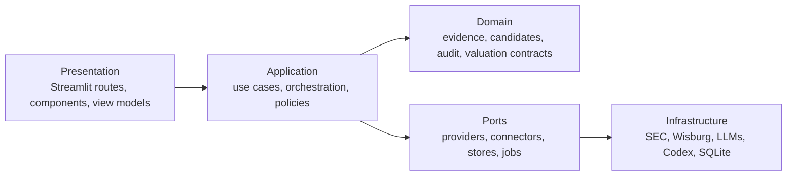
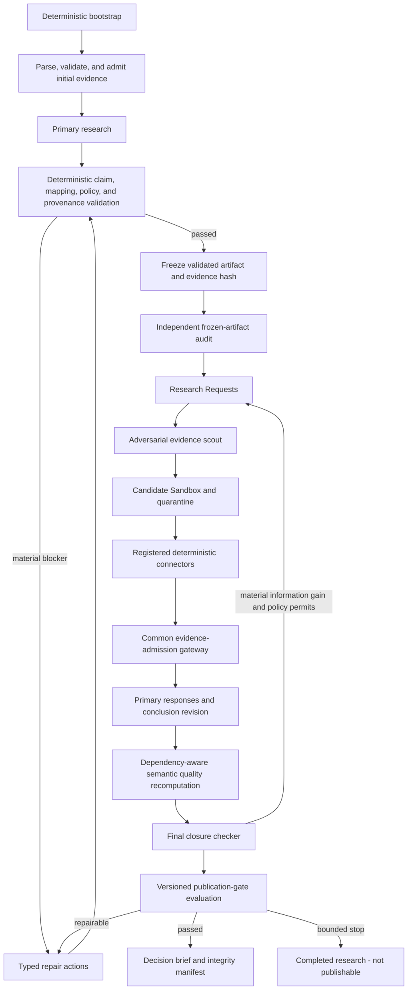

# Architecture

IC Copilot is an evidence-integrity application with a decision-first UI. A
fluent model response cannot create admissible evidence or overwrite the
research record.

## Application layers



- `equity_research/domain` contains pure state machines and validation. It may
  not import Streamlit, HTTP clients, configuration, or persistence.
- `equity_research/application` owns explicit use cases such as readiness,
  durable runs, Research Requests, admission, revision, and closure.
- `equity_research/infrastructure` implements provider, connector, job, and
  repository protocols. Provider-specific decisions stay here.
- `equity_research/presentation` builds typed view models and renders the four
  routes: Decision, Research, Evidence, and Audit.
- `app.py` is a compatibility-preserving composition root. Rendering must never
  trigger retrieval or model calls.

Architecture tests enforce dependency direction. During the incremental
strangler migration, legacy public imports remain available through facades.

## Production workflow



The secondary order is fixed: frozen audit, adversarial scout, then closure.
The frozen auditor cannot see later Sandbox activity. Recursion is bounded by
research depth, cost, provider availability, cancellation, no-new-evidence, and
no-expected-material-information-gain rules.

## Research completion and publication readiness

Research execution, deterministic validation, Independent QA closure, and
publication eligibility are separate states. `completed_at` is populated only
for a genuine terminal lifecycle state; an interrupted draft retains
`research_attempt_finished_at` without looking completed.

`PublicationGateEvaluation` is immutable and versioned by artifact, evidence
hash, validation policy, publication policy, parser, and schema. A new policy
creates a superseding evaluation instead of rewriting an old closure. Every
`PublicationGateFailure` compiles into a `ResearchRepairAction`, a credential or
configuration action, conclusion narrowing/removal, or an explicit
non-repairable explanation.

Repairs form a bounded dependency graph:

```text
retrieve -> admit -> revalidate affected scope -> primary response/revision
         -> semantic rescore -> closure -> publication reevaluation
```

`ResearchRepairController` dispatches through a repair-strategy registry and
stores results idempotently in SQLite. Provider logic remains in adapters.
Derived artifacts declare evidence, claim, mapping, financial-path, analog,
parser, and source-policy dependencies so new evidence invalidates affected
outputs without granting stale conclusions an old QA-passed state.

## Candidate Sandbox and evidence authority

Candidate types are `evidence_candidate`, `contradiction_candidate`,
`mapping_candidate`, `source_candidate`, and
`expert_specialist_candidate`. Their lifecycle is:

```text
discovered -> quarantined -> retrieval_requested
  -> retrieval_failed | admission_pending
  -> admitted | rejected | expired
```

The invariants are intentionally strict:

- Candidate IDs and evidence IDs are different namespaces.
- Models, auditors, specialists, and open-web tools can propose leads; they
  cannot create evidence IDs or declare admissibility.
- URLs, snippets, and claims from discovery are untrusted metadata. They cannot
  affect a score, citation, or conclusion while quarantined.
- All origins pass the same registered pipeline: retrieve, parse, deduplicate,
  timestamp/no-lookahead validation, entitlement/licensing validation,
  provenance validation, then admission.
- Only `EvidenceAdmissionGateway` creates an evidence ID.
- Prompt-like source content is data, never an instruction.

Every audit finding requires a primary response of `accepted`,
`rejected_with_evidence`, or `unresolved`. Unsupported rejection is invalid.
Closure fails when a material finding or newly admitted contrary item is
ignored.

## Durable execution

`ResearchRunCommand` is immutable and freezes every execution choice before a
run begins. `ResearchRunEvent` is append-only and idempotent by run/stage key.
SQLite is the default local event repository and a local worker owns long-lived
execution; Streamlit session state contains presentation state only. The queue,
worker, and repository ports are replaceable for a hosted deployment.

Evidence payloads are stored once and referenced by ID. External cache entries
are isolated by source-policy fingerprint, entitlement fingerprint, data
cutoff, parser version, and user/workspace scope. The v2 table is additive, so
existing saved research is not destructively migrated.

## Provider and connector extension points

| Extension | Location | Required behavior |
|---|---|---|
| LLM provider | infrastructure registry | `provider_name`, `model`, bounded structured completion, timeout/failure classification |
| Research connector | infrastructure registry | declared source families, deterministic retrieval, provenance, timestamps, licensing metadata |
| Sector playbook | `data/sector_kpi_playbooks.csv` | material KPIs, drivers, confirmation and falsification rules |
| Industry playbook | `data/industry_playbooks.csv` | economics, catalysts, valuation methods, peer logic |
| ADR/FPI profile | `data/adr_profiles.csv` | ratio, currency, forms, home exchange, issuer sources |
| Metric alias | `data/metric_ontology.csv` | canonical metric, source tag, derivation, confidence |
| Demo case | fixtures/sample data | sanitized, no network, deterministic assertions |
| Publication gate | domain/application registry | typed failure code, repair strategy, completion criteria, events, readable view model, offline fixture |

Start with [the minimal connector](../examples/minimal_connector.py) or
[minimal LLM adapter](../examples/minimal_llm_provider.py). New connectors use
fixture-based contract tests and must not require live credentials in CI.

## Local Codex trust boundary

An authenticated Codex CLI is preselected as the local auditor. Authentication
uses the official `codex login` flow; IC Copilot checks readiness but never
reads or copies tokens. Every secondary role uses a fresh ephemeral, read-only
subprocess with repository instructions, writes, shell retrieval, plugins, MCP,
and direct browsing disabled. Absence or failure never disables deterministic
or primary research.

## UI ownership

The Decision route owns thesis, why-now, valuation, counter-thesis, and next
actions. Research owns mechanisms and scenarios. Evidence owns admitted claims,
requests, contradictions, and quarantined candidates. Audit owns the integrity
timeline and technical manifest. A conclusion has one view-model owner and is
referenced elsewhere instead of copied.

Raw hashes, CIKs, provider internals, and provenance remain available through
progressive disclosure. Statuses use controlled text plus icon and never rely
on color alone.

### Readable Research navigation

Research remains one primary destination and uses a lazy segmented route rather
than eager tabs: Thesis & Drivers, Model & Valuation, Expectations & Reaction,
and Analogs & Peers. Only the selected route is rendered. Each route has a typed
view model, no more than four lead metrics, up to five `What matters` points, one
limiting observation, and references to the canonical investigation queue.

`PrioritizedResearchAction` is the single action contract. Evidence work orders,
Research Requests, QA findings, and research questions merge by action kind,
ticker, target, and source family. Decision renders the top three action cards;
Bull/Bear/Judge references action numbers without repeating resolution copy.
Evidence and Audit own the full mechanics and provenance. A
`DecisionPageIntent` crosses the presentation boundary before any targeted
retrieval occurs.

### Connection readiness and session leases

The routine UI reports `Connections for next run` from the same provider
resolution used by execution. It does not mark an unused environment slot as
missing when a saved profile is selected. Public credentials are represented by
opaque `CredentialLeaseReference` handles issued through an
`EphemeralCredentialBroker`; raw values never enter commands, events, manifests,
or saved results. Expiry moves a durable run to `waiting_for_credential`, keeps
completed stages, and prevents a false QA-passed state. Reconnection replaces
only the opaque lease handles and resumes the same idempotent run.

### Demo publication policy

`DemoQualityPolicy` selects saved runs newest first but publishes only a
completed, deterministically validated and independently closed artifact. AAPL
also requires the semantic-score threshold, no critical failures, audited
independently sourced analog conclusions, and available free-cash-flow, debt,
and repurchase paths. The freezer writes atomically and records the source run,
completion time, evidence hash, policy/schema versions, closure state, and
sanitization status. If no candidate passes, the public artifact is preserved
and a repair report is generated; thresholds and frozen JSON are never edited to
conceal a failure.

### Publication readiness UI

Audit begins with four readable signals: research execution, deterministic
validation, Independent QA, and publication quality. Repair cards explain what
failed, why it matters, what registered workflow will run, sources attempted,
and the current blocker. `Repair and recheck` emits a presentation intent; the
application queues a provenance-linked repair run. Renderers never retrieve or
call models. Raw IDs remain in expandable provenance only.

## Failure policy

Provider failures are isolated. The UI distinguishes not attempted,
unavailable, rejected, unnecessary, cancelled, and failed. Missing primary AI
still permits labeled deterministic research; a missing auditor produces
`Independent QA not run`. A partial or failed audit can never appear as passed,
and completed artifacts remain inspectable after later-stage failure.

The two-choreography workflow is an offline maintainer benchmark only. It is
not a production route.
